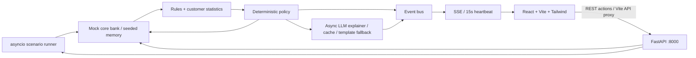

# Ordo Sentinel
**Team ordo_system · CIS Hack: Protect the little guy: human & transaction**

Start here: [Goal / scope](GOAL.md) · [Owner tasks](TASKS.md) · [Progress log](PROGRESS.md).

## Pitch
Authentication passed. Intent did not. Ordo Sentinel is bank-side autonomous transaction defense with a customer guardian UI.

## Problem
At 2 AM, an asleep customer's account is drained through API-authorized transfers—even though FaceID, video KYC and authentication all passed. The final instruction is a **−AED 450,000 offshore wire**.

## Solution
Detect unusual money movement, hold suspicious transfers and freeze the offending API client/consent token before posting. Explain the intervention in plain English/Arabic and let the customer deny it out of band. **Rules and per-customer statistics decide; an LLM only explains. No trained ML.**

## Architecture

Single Python process; one frontend app with **/phone** and **/analyst**. No real banking integration.

## How to run
Python 3.10+; from the repository root:
```sh
cd backend
python -m venv .venv
source .venv/bin/activate
pip install -r requirements.txt
uvicorn app.main:app --port 8000
```
Use **one worker** (in-memory state). Open http://localhost:8000/docs for interactive API docs; synthetic fixtures are served at /fixtures/state.json, /fixtures/transactions.json, /fixtures/alerts.json and /fixtures/events.ndjson.

In another terminal, from backend/ with the virtualenv active:
```sh
python -m pytest -q
curl http://localhost:8000/api/state
curl -X POST http://localhost:8000/api/scenario/drain/start
curl -N --max-time 12 http://localhost:8000/api/stream
curl -X POST http://localhost:8000/api/alerts/alert_wire/decision -H 'Content-Type: application/json' -d '{"decision":"deny"}'
curl -X POST http://localhost:8000/api/reset
```
The stream intentionally remains open (curl exits 28 at its timeout). Connect before starting scenarios for every event; there is no replay. Drain takes ~2 seconds, freezes the wire and waits for a real Deny, raising protected_amount to 450000. Run normal first for the AED 519915 posted-balance checkpoint.

- Frontend implementation pending: Vite should proxy /api to http://localhost:8000; CORS permits http://localhost:5173.
- Frontend mock mode: VITE_USE_MOCK=true; load fixtures and replay events.ndjson without backend.
- Backend Phase 0 uses fixture risk and template explanations; see [module ownership / remaining work](docs/MODULES.md). Automatic alert expiry, statistical baseline and live LLM are not implemented yet.
- Start with [plan](docs/PLAN.md), [API contract](docs/API_CONTRACT.md), and [frontend handoff](docs/FRONTEND_BRIEF.md).
- Data is synthetic; dates are a fixed demo clock, not wall-clock scheduling.

## Team
**ordo_system** — backend owner ByelNegm + Devin; frontend colleague + a separate Devin session. Deadline **16:00 Asia/Dubai**; submit by **15:30**; MVP only. Devin parallel work and Cap recording will be shown in the submission. Repository: https://github.com/ByelNegm/ordo-sentinel.
