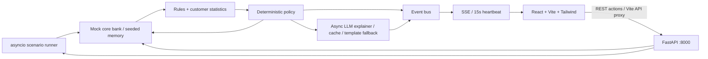

# Ordo Sentinel
**Team ordo_system · CIS Hack: Protect the little guy: human & transaction**

Start here: [Goal / scope](GOAL.md) · [Owner tasks](TASKS.md) · [Progress log](PROGRESS.md).

## Pitch
Authentication passed. Intent did not. Ordo Sentinel is bank-side autonomous transaction defense with a customer guardian UI.

## Problem
At 2 AM, an asleep customer's account is drained through API-authorized transfers—even though FaceID, video KYC and authentication all passed. The final instruction is a **−AED 450,000 offshore wire**.

## Solution
Detect unusual money movement, hold suspicious transfers and freeze the offending API client/consent token before posting. Explain the intervention in plain English/Arabic and let the customer deny it out of band. **Rules and per-customer statistics decide; an LLM only explains. No trained ML.**

## Architecture

Single Python process; one frontend app with **/phone** and **/analyst**. No real banking integration.

## How to run (placeholder — implementation not started)
- Backend will run FastAPI on :8000 in one worker; setup/launch commands TBD in backend/.
- Frontend will run Vite with /api proxied to http://localhost:8000; setup commands TBD in frontend/.
- Frontend mock mode: VITE_USE_MOCK=true; load fixtures and replay events.ndjson. No server required beyond the future Vite dev server.
- Start with [plan](docs/PLAN.md), [API contract](docs/API_CONTRACT.md), and [frontend handoff](docs/FRONTEND_BRIEF.md).
- Data is synthetic; dates are a fixed demo clock, not wall-clock scheduling.

## Team
**ordo_system** — backend owner ByelNegm + Devin; frontend colleague + a separate Devin session. Deadline **16:00 Asia/Dubai**; submit by **15:30**; MVP only. Devin parallel work and Cap recording will be shown in the submission. Repository: https://github.com/ByelNegm/ordo-sentinel.
